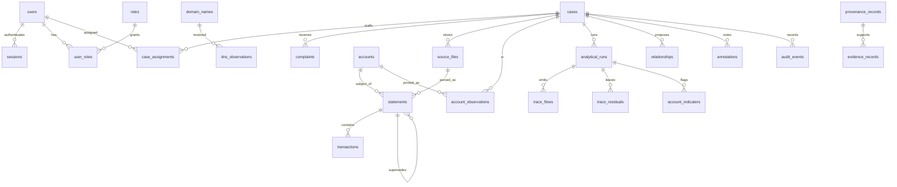

# Database implementation specification

PostgreSQL 16. Names, keys, and immutability follow
[Database design](DATABASE_DESIGN.md) and ADRs 0010–0014. This file is the
column contract for the migration.

The migration does not create a second investigation table, a risk-score
table, a wallet key, a certificate table, or a graph-node table. NetworkX
does not have a schema.

## Conventions

- Primary keys are `uuid` and default to `gen_random_uuid()`, except the
  composite keys named below and `audit_events.id`, which is `bigint`
  generated always as identity.
- `created_at` and other instants are `timestamptz`, UTC, default `now()`.
- A date with no time is `date`. Do not store midnight to fill a missing time.
- Money is `numeric(20, 4)`, always greater than zero where it is an amount,
  and never a float. API JSON uses decimal strings.
- `currency` is `char(3)`, required, no default.
- Enable `citext` for usernames. Do not enable `pgcrypto`.
- `text` columns that are enums use a `CHECK`. Application enums match the check.
- Instrument tables `accounts`, `domain_names`, and `ip_addresses` have no
  classification and no holder name.
- Every other fact table has `data_classification` in
  `official`, `public_intelligence`, `synthetic`, `derived`, `unverified`.
- Phase 1 deployments run `VAGEXA_DATA_MODE=synthetic` and the application
  rejects `official` on case insert. The reverse rejection exists for a later
  operational process.
- Append-only tables reject `UPDATE` and `DELETE` with a trigger. Workflow
  tables may update only the columns named on that table.
- There is no `updated_at` on an append-only table. Workflow tables that
  change status do not pretend the old status was never stored: the change
  is also an `audit_events` row (finding M03).

## Record classes

| Class | Tables | Who writes them |
| --- | --- | --- |
| Source | `source_files`, and the bytes they point at | Upload |
| Normalised | `statements`, `transactions`, `account_observations`, `dns_observations`, `hosting_observations` | Parser or an explicit observation insert |
| Derived | `analytical_runs`, `trace_seeds`, `trace_flows`, `trace_residuals`, `account_indicators`, `findings`, `finding_support` | A versioned method |
| Analyst-created | `cases`, `complaints`, `annotations`, `relationships` decisions, `account_party_links` created by a person | An assigned user |
| Identity | `users`, `roles`, `user_roles`, `sessions`, `case_assignments` | Administrator, or the login use case |
| Keys | `accounts`, `domain_names`, `ip_addresses` | First sight of a normalised key. Not updated. |

`parties` are analyst-created and are not inferred from similar names.
Phase 1 code does not insert them from a parse.

## Tables evaluated and not created

| Proposed table | Decision |
| --- | --- |
| `investigations` separate from `cases` | Not created. A case is the investigation. |
| `risk_assessments` | Not created. A score would be read as suspicion. Indicators already store the rule match. |
| `graph_nodes` / `graph_edges` | Not created. The graph is computed per request. ADR 0004. |
| `certificate_observations`, `autonomous_systems` | Not in the Phase 1 migration. Phase 3. Do not overload `dns_observations`. |
| `login_attempts` | Not created. Failed logins are `audit_events`. |

## Identity

### `users`

Workflow. Purpose: local account.

| Column | Type | Null | Rule |
| --- | --- | --- | --- |
| `id` | uuid | no | Primary key |
| `username` | citext | no | Unique, 3–64 chars, `^[a-zA-Z0-9._-]+$` |
| `password_hash` | text | no | Argon2id hash, never the password |
| `display_name` | text | no | 1–120 chars |
| `status` | text | no | `active` or `disabled` |
| `created_at` | timestamptz | no | |

Index: unique `username`. No `updated_at`. Status changes are audited.
Disabled users cannot start a session.

### `roles`

| Column | Type | Null | Rule |
| --- | --- | --- | --- |
| `id` | smallint | no | Primary key |
| `name` | text | no | Unique. Seed: `administrator`, `investigator`, `analyst`, `auditor` |

### `user_roles`

Primary key `(user_id, role_id)`. Foreign keys to `users` and `roles`, both
`ON DELETE RESTRICT`.

### `sessions`

| Column | Type | Null | Rule |
| --- | --- | --- | --- |
| `id` | uuid | no | Primary key. Not the cookie value. |
| `user_id` | uuid | no | FK `users` |
| `token_hash` | text | no | Unique SHA-256 of the opaque cookie token |
| `created_at` | timestamptz | no | |
| `expires_at` | timestamptz | no | 12 hours from creation in Phase 1 |
| `revoked_at` | timestamptz | yes | Set on logout |
| `user_agent` | text | yes | Truncate to 256 chars |
| `client_ip` | inet | yes | Session review only. Not copied into analytical logs |

The raw token is 32 bytes from `secrets.token_urlsafe`. Only the hash is stored.

### `case_assignments`

Primary key `(case_id, user_id)`.

| Column | Type | Null | Rule |
| --- | --- | --- | --- |
| `case_id` | uuid | no | FK `cases` |
| `user_id` | uuid | no | FK `users` |
| `case_role` | text | no | `lead`, `investigator`, `analyst`, `auditor` |
| `assigned_at` | timestamptz | no | |
| `assigned_by` | uuid | no | FK `users` |

A global role does not override `case_role`.

## Casework

### `cases`

| Column | Type | Null | Rule |
| --- | --- | --- | --- |
| `id` | uuid | no | PK |
| `reference` | text | no | Unique, 1–64 chars |
| `title` | text | no | 1–200 chars |
| `status` | text | no | `open` or `closed`. Phase 1 creates `open`. Closing is Phase 2. |
| `data_classification` | text | no | `synthetic` in this release |
| `synthetic_batch_id` | uuid | yes | Required when classification is `synthetic`. FK `synthetic_batches`. Null otherwise. |
| `opened_on` | date | no | |
| `created_by` | uuid | no | FK `users` |
| `created_at` | timestamptz | no | |

Check: synthetic iff `synthetic_batch_id` is not null.
The creator is inserted into `case_assignments` as `lead` in the same transaction.
`title` may be corrected by an administrator who is assigned, and that change is audited. Classification is not updated.

### `complaints`

Append-only narrative. FK `cases`, FK `provenance_records`.

| Column | Type | Null | Rule |
| --- | --- | --- | --- |
| `id` | uuid | no | PK |
| `case_id` | uuid | no | FK |
| `external_reference` | text | yes | Unique with `case_id` when not null |
| `reported_at` | timestamptz | yes | |
| `narrative` | text | no | May be empty string. Not logged. |
| `data_classification` | text | no | Matches the case for `synthetic` |
| `provenance_id` | uuid | no | FK |
| `created_at` | timestamptz | no | |

### `parties`

Analyst-created. Not written by the parser.

| Column | Type | Null | Rule |
| --- | --- | --- | --- |
| `id` | uuid | no | PK |
| `display_name` | text | no | Immutable. A correction is a new party. |
| `party_kind` | text | no | `person`, `organisation`, `unknown` |
| `data_classification` | text | no | |
| `created_at` | timestamptz | no | |

### `accounts`

Append-only instrument key.

| Column | Type | Null | Rule |
| --- | --- | --- | --- |
| `id` | uuid | no | PK |
| `kind` | text | no | `bank` or `vpa`. Reject `wallet`. |
| `account_number_norm` | text | yes | Digits and letters, spaces removed. Required with `ifsc_norm` for `bank`. |
| `ifsc_norm` | text | yes | `^[A-Z]{4}0[A-Z0-9]{6}$` when present |
| `vpa_norm` | text | yes | Lowercased. Required for `vpa`. |
| `created_at` | timestamptz | no | |

Partial unique indexes: `(account_number_norm, ifsc_norm)` where both not null;
`vpa_norm` where not null.
Check: `bank` rows have number and IFSC and a null VPA. `vpa` rows have VPA and null number and IFSC.

### `account_observations`

Append-only. One row per printed occurrence. Do not update a name in place.

| Column | Type | Null | Rule |
| --- | --- | --- | --- |
| `id` | uuid | no | PK |
| `account_id` | uuid | no | FK `accounts` |
| `case_id` | uuid | no | FK `cases` |
| `statement_id` | uuid | yes | FK `statements` |
| `account_number_raw` | text | yes | As printed |
| `holder_name_raw` | text | yes | As printed. Two values are two rows. |
| `bank_name_raw` | text | yes | |
| `data_classification` | text | no | |
| `provenance_id` | uuid | no | FK |
| `created_at` | timestamptz | no | |

Index `(case_id, account_id)`.

### `account_party_links`

Append-only. Phase 1 inserts a row only when an investigator explicitly
attributes a party. A holder name on a statement does not create one.

| Column | Type | Null | Rule |
| --- | --- | --- | --- |
| `id` | uuid | no | PK |
| `account_id` | uuid | no | FK |
| `party_id` | uuid | no | FK |
| `link_kind` | text | no | `named_holder` or `investigator_attributed` |
| `assertion_kind` | text | no | `named_holder` from a statement field is `verified` against that field. `investigator_attributed` is `hypothesis` until a source field states it, and stays the investigator's act either way. |
| `provenance_id` | uuid | no | FK |
| `created_by` | uuid | no | FK `users` |
| `created_at` | timestamptz | no | |

### `annotations`

Append-only analyst note. Not a finding and not an assertion upgrade.
Added for the case screen, as finding M04 required once that screen exists.

| Column | Type | Null | Rule |
| --- | --- | --- | --- |
| `id` | uuid | no | PK |
| `case_id` | uuid | no | FK |
| `target_kind` | text | no | `case`, `account`, `transaction`, `relationship`, `observation` |
| `target_id` | uuid | no | Must exist for that kind inside the case. Checked in the use case. |
| `body` | text | no | 1–4000 chars. Not logged. |
| `created_by` | uuid | no | FK `users` |
| `created_at` | timestamptz | no | |

Index `(case_id, created_at)`.

## Statements and transactions

### `source_files`

Bytes live at `storage_key`, a server-generated relative path
`{case_id}/{uuid}`. `original_filename` is metadata and is never concatenated
into the path.

| Column | Type | Null | Rule |
| --- | --- | --- | --- |
| `id` | uuid | no | PK |
| `case_id` | uuid | no | FK |
| `sha256` | char(64) | no | Lower hex |
| `byte_size` | bigint | no | `> 0` and `<=` the upload limit |
| `original_filename` | text | no | Stored. Not a path. |
| `media_type` | text | no | `text/csv` in Phase 1 |
| `storage_key` | text | no | Unique |
| `status` | text | no | `stored`, `parsed`, `rejected`. Updates audited. |
| `data_classification` | text | no | |
| `uploaded_by` | uuid | no | FK `users` |
| `uploaded_at` | timestamptz | no | |
| `provenance_id` | uuid | no | FK |

Unique `(case_id, sha256)`.

### `statements`

`account_id` is not null. It is the subject account supplied with the upload.

| Column | Type | Null | Rule |
| --- | --- | --- | --- |
| `id` | uuid | no | PK |
| `case_id` | uuid | no | FK |
| `source_file_id` | uuid | no | FK |
| `account_id` | uuid | no | FK `accounts` |
| `parser_name` | text | no | `csv_canonical` |
| `parser_version` | text | no | `csv_canonical.v1` |
| `period_start` | date | yes | |
| `period_end` | date | yes | Must be `>= period_start` when both set |
| `currency` | char(3) | no | |
| `institution_name` | text | yes | |
| `data_classification` | text | no | |
| `provenance_id` | uuid | no | FK |
| `supersedes_statement_id` | uuid | yes | FK `statements`. Same case and same source file. |

Analytical reads exclude a statement that is the target of another row's
`supersedes_statement_id`.

### `transactions`

Append-only. Unique `(statement_id, line_number)`.

| Column | Type | Null | Rule |
| --- | --- | --- | --- |
| `id` | uuid | no | PK |
| `statement_id` | uuid | no | FK |
| `case_id` | uuid | no | FK. Must equal the statement's case. |
| `line_number` | integer | no | `> 0` |
| `booking_date` | date | no | |
| `booking_time` | time | yes | Null when precision is `date` |
| `value_date` | date | yes | |
| `time_precision` | text | no | `date` or `time`. `time` requires `booking_time`. |
| `direction` | text | no | `debit` or `credit` |
| `amount` | numeric(20,4) | no | `> 0`. Reject more than four decimal places in the parser. |
| `currency` | char(3) | no | Must equal the statement currency in Phase 1 |
| `balance_after` | numeric(20,4) | yes | Not a check against the previous row in Phase 1 |
| `rail` | text | no | `upi`, `imps`, `neft`, `rtgs`, `cash`, `cheque`, `card`, `internal`, `unknown` |
| `counterparty_raw` | text | yes | |
| `reference_raw` | text | yes | |
| `narration_raw` | text | no | Default `''` |
| `extracted_vpa` | text | yes | Only from `narration_extractor.v1` |
| `extracted_utr` | text | yes | Same |
| `extractor_version` | text | yes | Null when nothing was extracted |
| `counterparty_account_id` | uuid | yes | FK `accounts` |
| `counterparty_resolution` | text | no | `structured_field`, `narration_pattern`, `unresolved` |
| `data_classification` | text | no | |
| `provenance_id` | uuid | no | FK |

Indexes: `(case_id, booking_date, booking_time, line_number)`,
`(counterparty_account_id)`.

`structured_field` is `verified` against the CSV. `narration_pattern` is
`inferred`. `unresolved` creates no counterparty edge.

## Derived results

### `analytical_runs`

| Column | Type | Null | Rule |
| --- | --- | --- | --- |
| `id` | uuid | no | PK |
| `case_id` | uuid | no | FK |
| `run_kind` | text | no | `trace`, `indicators`, `correlation`, `copilot` |
| `method_name` | text | no | |
| `method_version` | text | no | |
| `parameters` | jsonb | no | Policy knobs only |
| `input_hash` | char(64) | no | |
| `output_hash` | char(64) | yes | Set when the run succeeds. Not updated after that; a failed run stores the error and stops. |
| `status` | text | no | `running`, `succeeded`, `failed` |
| `error_code` | text | yes | Enum-like code, not a narration |
| `requested_by` | uuid | no | FK `users` |
| `created_at` | timestamptz | no | |

Status transitions are the one allowed update, and they are audited. After
`succeeded` or `failed`, a further update fails the trigger.

### `trace_seeds`

Primary key `(analytical_run_id, transaction_id)`.
`complaint_id` nullable FK. Both transaction and complaint must be in the run's case.

### `trace_flows`

Append-only.

| Column | Type | Null | Rule |
| --- | --- | --- | --- |
| `id` | uuid | no | PK |
| `analytical_run_id` | uuid | no | FK |
| `case_id` | uuid | no | FK |
| `origin_complaint_id` | uuid | yes | FK |
| `from_account_id` | uuid | no | FK `accounts` |
| `to_account_id` | uuid | yes | FK `accounts` |
| `exit_kind` | text | yes | `cash` or `unresolved` |
| `source_transaction_id` | uuid | no | FK `transactions` |
| `amount` | numeric(20,4) | no | `> 0` |
| `currency` | char(3) | no | |
| `layer_to` | integer | no | 1–5 in Phase 1 output. Check allows 0–5. |
| `assertion_kind` | text | no | |
| `method_name` | text | no | |
| `method_version` | text | no | |

Check: (`to_account_id` is not null and `exit_kind` is null) or
(`to_account_id` is null and `exit_kind` is not null).

### `trace_residuals`

Append-only. `reason` in `no_onward_record`, `outside_horizon`, `unallocated`.
`account_id` FK. `amount` `> 0`.

### `account_indicators`

Append-only. `code` in `FAN_IN`, `FAN_OUT`, `PASS_THROUGH` for Phase 1.
`assertion_kind` is `inferred`. `limitations` is non-empty.
`support_transaction_ids` is `uuid[]` and must be non-empty.

### `findings` and `finding_support`

`findings` is append-only: `id`, `analytical_run_id`, `case_id`,
`finding_kind`, `summary`, `assertion_kind`, `limitations` non-empty,
`method_name`, `method_version`.

`finding_support` primary key `(finding_id, evidence_id)`, both FKs.
A trace run writes one finding whose limitations include the horizon and the
coverage sentence. An indicator run writes one finding per fired code.

## Infrastructure

### `domain_names`

`id` uuid PK, `name_norm` text unique, `created_at`.
Normalise: trim, lowercase, strip one trailing dot, reject spaces and empty.

### `ip_addresses`

`id` uuid PK, `address` inet unique, `created_at`.

### `dns_observations`

Append-only. `id`, `domain_id` FK, `rrtype` (`A` or `AAAA` in Phase 1),
`rdata` text, `observed_at` timestamptz, `resolver` text,
`provenance_id` FK, `data_classification`.
Index `(domain_id, observed_at)`.
Phase 1 rows are investigator-supplied. `resolver` is `investigator_entry`
unless a test double writes `fake_resolver`.

### `hosting_observations`

`id`, `case_id` (required for an investigator note), `ip_address_id` nullable
FK, `provider_name` nullable text, `source_note` text, `observed_at`,
`provenance_id`, `data_classification`.
No `autonomous_system_id` column in this migration.
A public mapping with no case narrative is not used in Phase 1. `case_id` is
not null.

## Relationships and evidence

### `relationships`

`case_id` is not null. There is no global relationship row.

| Column | Type | Null | Rule |
| --- | --- | --- | --- |
| `id` | uuid | no | PK |
| `case_id` | uuid | no | FK |
| `from_kind` | text | no | `account`, `party`, `complaint`, `domain`, `ip` |
| `from_id` | uuid | no | Checked in the use case. No polymorphic FK. |
| `to_kind` | text | no | Same set |
| `to_id` | uuid | no | |
| `rel_type` | text | no | `mentioned_in`, `infrastructure_overlap`, `shared_domain_name`, `same_payment`, `possible_same_party` |
| `assertion_kind` | text | no | `verified`, `inferred`, `hypothesis` |
| `method_name` | text | no | |
| `method_version` | text | no | |
| `status` | text | no | `proposed`, `confirmed`, `rejected` |
| `limitation` | text | no | Non-empty. Overlap rows include the non-ownership sentence. |
| `provenance_id` | uuid | no | FK |
| `created_by` | uuid | no | FK |
| `created_at` | timestamptz | no | |
| `decided_by` | uuid | yes | FK |
| `decided_at` | timestamptz | yes | |

The only allowed update is `status`, `decided_by`, `decided_at`, and only
from `proposed`. Confirm does not change `assertion_kind`.
Index `(case_id, status)`.

Cross-case account co-occurrence is not stored here. It is a query.

### `resolution_decisions`

Not written in Phase 1. The table is still created so a later merge does not
rewrite history: `id`, `left_kind`, `left_id`, `right_kind`, `right_id`,
`decision` (`merge` or `reject`), `reason`, `decided_by`, `created_at`.
No Phase 1 route inserts it.

### `provenance_records`

Append-only. `id`, `data_classification`, `source_system`
(`upload`, `investigator_entry`, `synthetic_generator`, `method`),
`source_reference` text, `collected_at`, `collected_by` text,
`method_name`, `raw_hash` char(64) null.

### `evidence_records`

Append-only. `id`, `case_id`, `provenance_id`, `kind`
(`source_file`, `transaction`, `observation`, `analytical_finding`, `report`, `annotation`),
`object_id` uuid, `content_hash` char(64), `supersedes_id` self-FK null,
`created_at`.

### `audit_events`

Append-only. `id` bigint identity, `occurred_at`, `actor_id` null,
`action` text, `case_id` null, `object_kind`, `object_id`, `request_id`,
`outcome` (`success`, `denied`, `failure`), `detail` jsonb.

`detail` may contain method names, tool names, a bundle hash, and a last-four
suffix. It must not contain a password, a token, a narration, a VPA, a full
account number, or a copilot question.

Required actions: `auth.login`, `auth.logout`, `auth.login_failed`,
`case.open`, `case.create`, `statement.upload`, `statement.reprocess`,
`trace.run`, `relationship.decide`, `copilot.query`, `report.export`,
`cross_case.lookup`, `annotation.create`, `user.create`, `assignment.create`.

### `copilot_queries`

Append-only. `id`, `case_id`, `actor_id`, `tool_name`, `mode`
(`deterministic` only in Phase 1; `assisted` is rejected while the provider
is `none`), `question_text` nullable, `tool_trace` jsonb,
`evidence_bundle_hash` char(64), `response` jsonb, `model_id` null,
`created_at`.

### `jobs`

| Column | Type | Null | Rule |
| --- | --- | --- | --- |
| `id` | uuid | no | PK |
| `kind` | text | no | `parse_statement`, `reprocess_statement`, `trace`, `indicators`, `correlation` |
| `case_id` | uuid | no | FK |
| `payload` | jsonb | no | Identifiers only. A trace or indicator job includes `analytical_run_id`. |
| `status` | text | no | `queued`, `running`, `succeeded`, `failed` |
| `attempts` | integer | no | Default 0. Maximum 3. |
| `locked_at` | timestamptz | yes | |
| `locked_by` | text | yes | Worker id |
| `error_code` | text | yes | No narration |
| `created_at` | timestamptz | no | |
| `finished_at` | timestamptz | yes | |

Index `(status, created_at)`. A lock older than 15 minutes may be reclaimed.

### `synthetic_batches`

`id`, `scenario_key`, `generator_version`, `ground_truth_sha256`, `created_at`.
The ground-truth file is not a column and is not readable through the API.

## Entity diagram

## Migration order

1. Extensions and triggers function.
2. `roles`, `users`, `user_roles`, `sessions`.
3. `synthetic_batches`, `cases`, `case_assignments`.
4. `provenance_records`.
5. `accounts`, `domain_names`, `ip_addresses`, `parties`.
6. `source_files`, `statements`, `transactions`, `account_observations`.
7. `complaints`, `annotations`, `dns_observations`, `hosting_observations`.
8. `relationships`, `account_party_links`, `resolution_decisions`.
9. `analytical_runs` and the trace, indicator, finding, and evidence tables.
10. `jobs`, `copilot_queries`, `audit_events`.
11. Append-only triggers and the relationship-column trigger.

Seed the four roles in the same migration. Seed no people and no cases.
