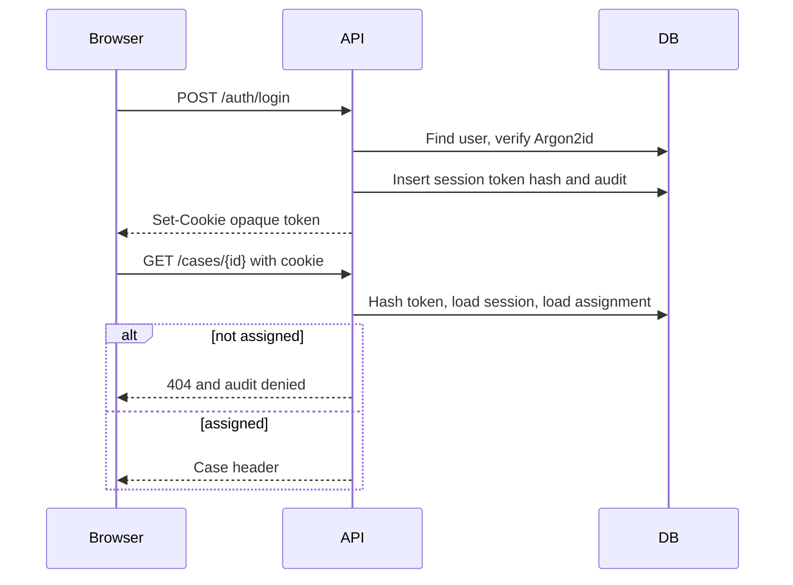

# Security implementation specification

This is the control list for the synthetic prototype and the additional list
that remains before any official record. It matches
[Security gap analysis](SECURITY_GAP_ANALYSIS.md) and ADR 0014. Nothing here
is implemented yet.

## Prototype controls, required for the demo

| Control | Implementation |
| --- | --- |
| Passwords | Argon2id via `argon2-cffi`. Pin memory 19456 KiB, time cost 2, parallelism 1 when the package is added, and record those integers in the test. If the OWASP Password Storage Cheat Sheet minimum differs on that day, use the cheat sheet and record the difference in the change. |
| Session | 32-byte opaque token, SHA-256 stored, 12-hour expiry. Cookie `HttpOnly`, `SameSite=Lax`. `Secure` on, except loopback HTTP when `VAGEXA_DATA_MODE=synthetic` and `VAGEXA_COOKIE_SECURE=false`. |
| Authorisation | Case routes check assignment after the session. Missing and unassigned are 404 with no title. Global administrator does not skip that check. |
| Case role | `lead` and `investigator` mutate. `analyst` runs traces, indicators, correlation, and copilot. `auditor` reads. Confirm and reject are investigator or lead. |
| Uploads | 25 MB. Server-generated storage key. CSV only. Subject account required. |
| Graph | Hop maximum 5. |
| Logs | JSON, request id, no password, token, narration, VPA, or full account number. Last four is allowed. |
| HTML | Escape every interpolated value in the report. |
| Data mode | Process refuses to start without `VAGEXA_DATA_MODE`. Synthetic mode rejects `official` cases. |
| Secrets | No default `VAGEXA_SESSION_SECRET`. Compose reads an untracked env file. Postgres is not published on the host. |
| Ground truth | No route returns it. |
| Passive intel | Off. The lookup route returns 409. |

Login failures: the tenth `auth.login_failed` for one username inside 15
minutes returns 429. Count them from `audit_events`. Do not add Redis.

## Flow

## Authorisation matrix

| Action | Lead or investigator | Analyst | Auditor | Administrator not assigned | Unassigned |
| --- | --- | --- | --- | --- | --- |
| Read case content | Yes | Yes | Yes | 404 | 404 |
| Upload, complaint, observation, annotation, report | Yes | No | No | 404 | 404 |
| Trace, indicators, correlate, copilot tool | Yes | Yes | No | 404 | 404 |
| Confirm or reject | Yes | 403 | 403 | 404 | 404 |
| Create user, assign | No | No | No | Yes | No |
| Cross-case narrative | Only if also assigned to that case | Same | Same | 404 on the other case | 404 |

403 is used when the caller can see the case and the role forbids the action.
404 is used when they cannot see the case. An analyst who can see the case and
calls confirm receives 403, not 404.

## Database

Phase 1 uses one database login plus the append-only triggers. That is
accepted for synthetic data only. The application role in a later operational
deployment is specified in the database design and is not part of this demo.

Queries that read case content include `case_id` and the assignment. An
account read loads observations only for assigned cases.

## Errors and files

Problem responses use the contract in the API document. Stack traces stay in
the server log without source rows.

The storage directory is `VAGEXA_STORAGE_DIR`. The process resolves the
storage key under that directory and rejects a key that escapes it.

## Before official records

Do not load operational data until TLS is enforced with no loopback exception,
database roles match the design, backups are encrypted and a restore has been
rehearsed, the identity provider replaces local passwords, full-account reveal
is audited, and a written retention rule exists. Those are Phase 4. This
specification does not implement them and does not invent a retention period.

## Explicit non-claims

Session cookies and SHA-256 do not make an export a court exhibit. The report
says the outputs are investigative aids.
